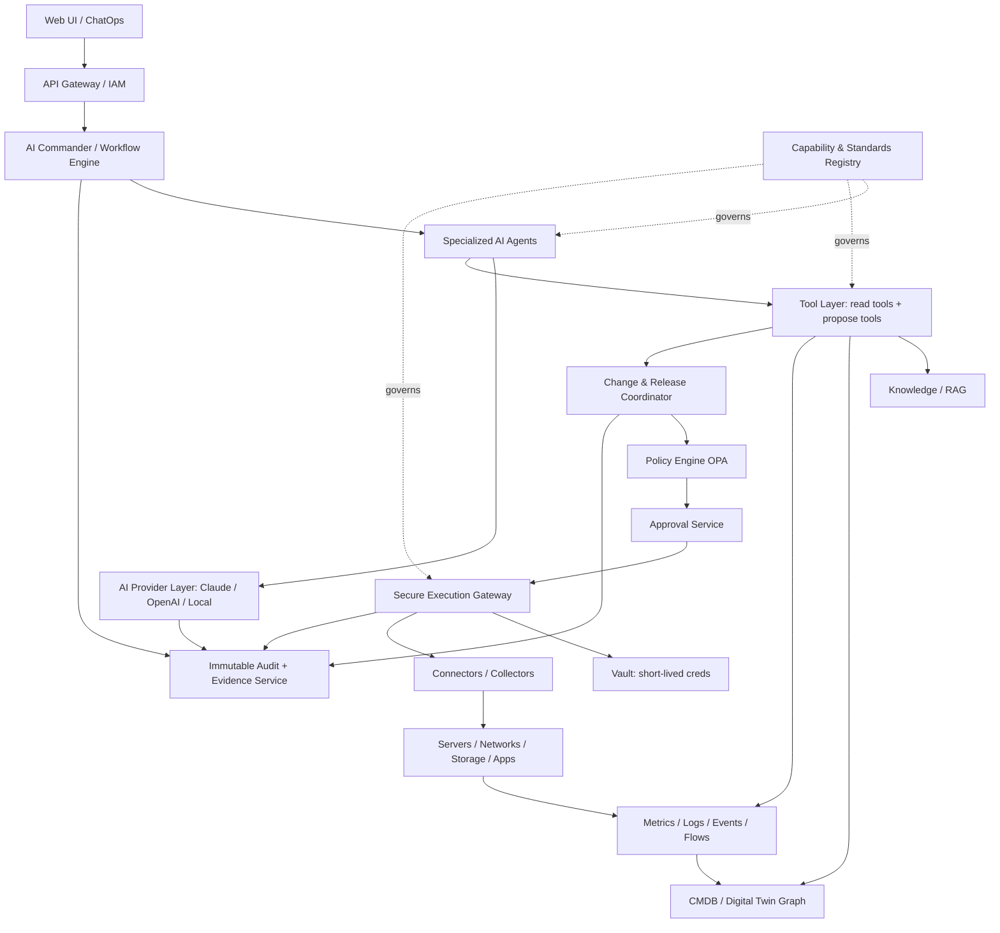

# AdminTwin

**ТЕХНИЧЕСКОЕ ЗАДАНИЕ**

**AI Infrastructure Digital Twin & Autonomous IT Operations Platform**

*OBSERVE · ANALYZE · AUTOMATE · SECURE*

**Версия 1.3.1 — окончательная редакция**

10 ноября 2026 г.

Часть I — Ядро ТЗ · Часть II — Standards Registry · Часть III — Capability Catalog · Часть IV — Operational Workflows

---

# Техническое задание v1.3.1 (окончательная редакция)

## AdminTwin — AI Infrastructure Digital Twin & Autonomous IT Operations Platform

**Продукт:** AdminTwin · слоган: Observe · Analyze · Automate · Secure

**Статус:** утверждаемое ТЗ для разработки

**Дата:** 10.11.2026

**Состав документа:** настоящее ядро + три приложения (части II–IV настоящего документа):

- **Приложение A** — Standards Registry (реестр международных стандартов и модель применимости)
- **Приложение B** — Capability Catalog (каталог профессиональных способностей, тиры, тесты, трассируемость)
- **Приложение C** — Operational Workflows (обязательные сквозные процессы и их state machines)

**Тип продукта:** коммерческая платформа, две редакции — Enterprise (self-hosted/on-premise, single-tenant) и SaaS (multi-tenant)

**Язык документа:** русский (нормативный); идентификаторы, имена полей и API — английский

**Язык интерфейса:** русский, казахский, английский (i18n)

> **Инварианты продукта.** LLM не имеет прямого доступа к производственным credentials и не выполняет произвольные команды. Любое изменение проходит через единый контур Change → Policy → Approval → Secure Execution Gateway → Audit. В режиме по умолчанию (Advisor) действия только предлагаются. Платформа не находится в критическом пути production: её отказ не влияет на работу наблюдаемой инфраструктуры. Ссылка на стандарт не означает сертификацию; соответствие подтверждается аудитом.

---

## 0. История изменений

| **Версия** | **Дата** | **Изменения** |
|---|---|---|
| 1.0 | 09.11.2026 | Первая редакция |
| 1.1 | 09.11.2026 | AI Provider Layer (Claude / OpenAI / Local), Tool Layer, модель угроз, evals, бюджеты, runbook-каталог, матрицы ролей и согласований, ретенция, деградация, MVP-срез, ADR |
| 1.2 | 09.11.2026 | Нормативное расширение: стандарты, capability registry, покрытие профессий, трассируемость, список противоречий |
| 1.3 | 09.11.2026 | Окончательная редакция. Исправления v1.2 внесены в текст (ретенция, rollback, kill switch, маскирование, legal hold). Документ разделён на ядро и три приложения. Введены: единая модель реестров (ER), единый контур Change/Execution/Approval, классификация инструментов read/propose, тиры P1a/P1b и статус `integration_only` для capabilities, роль Compliance Manager, purpose-of-access для evidence, crypto-shredding для ПДн в WORM, OSCAL/SCAP как формат compliance-данных, объекты environment/ring/service_tier, discovery scope document, коннекторы Git/CI, NetFlow в ретенции. Устранена двойная нумерация и ошибочные ссылки. Scope creep (IGA, GRC, DLP, Problem/Request Mgmt) переведён в `integration_only`. |
| **1.3.1** | 10.11.2026 | **Присвоено название продукта AdminTwin** и слоган «Observe · Analyze · Automate · Secure». Обновлены титул, идентификаторы (репозиторий `admintwin/`, домен ошибок API, артефакты). Содержание требований не изменено. |

---

## 1. Цели, редакции и границы

### 1.1 Цели

Платформа обнаруживает инфраструктуру, строит карту связей, собирает телеметрию, выявляет инциденты, устанавливает вероятную первопричину, координирует специализированных ИИ-агентов, предлагает изменения, исполняет строго разрешённые runbook-операции и проверяет их результат. Платформа одновременно является инструментом подтверждения инженерных процессов: каждое действие порождает evidence, пригодное для аудита.

**Базовые сценарии:** диагностика HTTP 502; отказ БД; исчерпание диска; отказ канала/VLAN; подозрительные входы; остановка Docker-контейнера; проверка резервных копий; оценка влияния изменения firewall; анализ перегрузки СХД.

### 1.2 Редакции

| **Редакция** | **Развёртывание** | **Tenancy** | **Целевой клиент** |
|---|---|---|---|
| **Enterprise** | self-hosted / on-premise | single-tenant (модель данных остаётся tenant-scoped) | университеты, госорганизации, банки, промышленность |
| **SaaS** | облако поставщика | multi-tenant с RLS | малый и средний бизнес, MSP |

Код общий. Изоляция tenant проектируется и тестируется с первого дня; **пилот и MVP выполняются в редакции Enterprise**.

Два тестовых tenant в MVP подтверждают изоляцию, а не коммерческую готовность SaaS.

### 1.3 Тиры поставки

| **Тир** | **Содержание** | **Гейт** |
|---|---|---|
| **MVP (P0)** | §1.4 | критерии §21 с пометкой [MVP] |
| **P1a — Enterprise Core** | capabilities тира P1a по профилю первого клиента (Приложение B) | ≥ 90% P1a-сценариев согласованного профиля |
| **P1b — Enterprise Resilience** | capabilities тира P1b | restore/failover, custody, control evidence |
| **P2 — Advanced Twin** | Time Machine, what-if, prediction, расширенная автономность | валидация симуляции, bounded risk |

Статус `integration_only` (Приложение B) означает: платформа читает данные из внешней системы и создаёт в ней записи через коннектор, но **не реализует** предметную функцию сама. Это относится к IGA, GRC, DLP, Problem/Request Management,

полноценному ITSM.

### 1.4 MVP-срез (первый релиз, оценка ~16 недель при двух параллельных командах)

- **Агенты (5):** AI Commander, Linux Admin, Network Engineer, DevOps Engineer, DBA Engineer.
- **Интеграции (4):** Linux/Ubuntu (SSH read-only), Docker API, FortiGate (read-only), PostgreSQL (read-only).
- **Сценарии (3):** HTTP 502, исчерпание диска, остановка контейнера.
- **Runbooks (3):** `docker.container.restart`, `linux.service.restart`, `linux.logs.rotate_cleanup`.
- **AI-провайдеры (3):** Claude, OpenAI, один локальный через OpenAI-совместимый endpoint.
- **Модули:** M01, M02, M03 (без расписаний), M04, M05 (метрики + события + syslog; без трасс и NetFlow), M06, M07, M08, M09, M10, M20 (изоляция), M21, M22 (базовый), M24, M25 (только справочник capabilities — без tests/evidence), M27 (минимальная сущность change).

Срок — оценка для этого среза; после discovery обязателен staffing/sizing и re-estimation. Полное покрытие профессий и стандартов в MVP не обещается.

### 1.5 Не входит в v1.x

Произвольная автономная эксплуатация; гарантированно точная физическая симуляция; опасные изменения без согласования; замена существующих SIEM/NMS/ITSM/GRC/IGA/DLP; fine-tuning моделей; сертификация организации по какому-либо стандарту.

---

## 2. Роли и права

### 2.1 Роли

- **Platform Super Admin** — инфраструктура платформы, глобальные шаблоны, лицензии; без автоматического доступа к секретам и evidence tenants.
- **Tenant Admin** — организация, подключение объектов, политики, AI-провайдеры, compliance-профиль.
- **IT Manager** — обзор, согласование изменений, отчёты.
- **Engineer** — одна роль со scope-атрибутами (sysadmin / network / devops / security / dba / sre).
- **Operator** — инциденты и утверждённые runbooks.
- **Compliance Manager** *(новая)* — compliance-профиль, статусы контролей, исключения, экспорт audit package; без прав исполнения.
- **Auditor** — чтение журналов, evidence и статусов контролей.
- **Forensic Analyst** *(scope, не роль)* — доступ к forensic cases и артефактам только с указанием purpose-of-access; каждый доступ журналируется.
- **Viewer** — мониторинг без управления.
- **AI Agent** — машинная идентичность; никогда не approver; никогда не получает секрет или shell.

RBAC + ABAC (tenant, site, asset, environment, criticality, time window, action risk, data class), OIDC/SAML SSO, MFA. Согласующий не может быть автором запроса.

### 2.2 Матрица «роль × действие»

| **Действие** | **Super Admin** | **Tenant Admin** | **IT Manager** | **Engineer** | **Operator** | **Compliance Mgr** | **Auditor** | **Viewer** | **AI Agent** |
|---|---|---|---|---|---|---|---|---|---|
| Просмотр активов/топологии | ✓ (без секретов) | ✓ | ✓ | ✓ scope | ✓ scope | ✓ | ✓ | ✓ | ✓ scope |
| Запуск discovery | — | ✓ | — | ✓ scope | — | — | — | — | ✓ read-only по policy |
| Создание AI-задачи | — | ✓ | ✓ | ✓ | ✓ | — | — | — | ✓ подзадачи |
| Предложить change/runbook | — | ✓ | ✓ | ✓ | ✓ | — | — | — | ✓ |
| Согласовать low/medium | — | ✓ | ✓ | ✓ своя область | — | — | — | — | **никогда** |
| Согласовать high | — | ✓ | ✓ | — | — | — | — | — | **никогда** |
| Согласовать critical (dual) | — | ✓ | ✓ | — | — | — | — | — | **никогда** |
| Break-glass emergency change | — | ✓ | ✓ | — | — | — | — | — | — |
| Изменить policy / режим автономности | — | ✓ | — | — | — | — | — | — | — |
| Runbook-каталог | ✓ глобальные | ✓ tenant | — | — | — | — | — | — | — |
| AI-провайдеры / ключи | — | ✓ | — | — | — | — | — | — | — |
| Compliance-профиль, статусы контролей | — | ✓ | — | — | — | ✓ | чтение | — | — |
| Evidence (просмотр) | — | ✓ | ✓ | своё | — | ✓ | ✓ | — | ссылки, не содержимое |
| Forensic artifacts | — | по purpose | — | по purpose (scope) | — | — | по purpose | — | — |
| Kill switch | ✓ | ✓ | ✓ | — | ✓ | — | — | — | — |
| Чтение аудита | ✓ платформенный | ✓ | ✓ | — | — | ✓ | ✓ | — | — |
| Лицензии / tenants | ✓ | — | — | — | — | — | — | — | — |

---

## 3. Архитектура

### 3.1 Логическая схема



### 3.2 Модель реестров (нормативная ER)

Все справочники платформы связаны одной моделью. Нет «параллельных» каталогов.

```
Module (M01..M27)          — группировка UI и сервисов; ссылается на capabilities
Agent (20)                 — allowed_capabilities[], model_profile, policy
Capability (Приложение B)  — domain, tier, mode(build|integration_only), standards[], operations[]
  └─ Operation             — level ∈ {observe, diagnose, recommend, propose, execute, verify, rollback}
       ├─ level ≤ recommend  → реализуется Tool (kind=read)
       ├─ level = propose    → реализуется Tool (kind=propose) → создаёт ChangeRequest
       └─ level ≥ execute    → реализуется Runbook (через Gateway, только из ChangeRequest)
Tool                       — kind ∈ {read, propose}; JSON Schema in/out; tenant-scoped; rate limit
Runbook                    — сертифицированная write-операция; risk; preflight; post_check; rollback|none+compensation
Test                       — привязан к capability/operation/runbook; обязателен для production_ready
Evidence                   — артефакт с digest, custody, retention_class, legal_hold
Standard (Приложение A)    — редакция, применимость; → Control → Capability
```

Правила: `approve` не является operation capability — это действие человека в Approval Service. AI Agent имеет только operations уровня ≤ propose. Любой `execute` исходит из ChangeRequest, а не из агента напрямую.

### 3.3 Tool Layer

Два класса инструментов:

- **read tools** — типизированные, read-only, tenant-scoped, с лимитом размера ответа, маскированием секретов, rate limit и проверкой источника данных. Пример: `metrics.query(asset_id, metric, window)`.
- **propose tools** — создают `ChangeRequest` с параметрами из runbook-каталога. Единственный способ для агента инициировать запись. Пример: `change.propose(runbook_id, params, reason, incident_id)`.

Вывод любого инструмента — недоверенный ввод, оборачивается разделителями с пометкой «данные, не инструкции».

### 3.4 Сервисы

identity, tenant, inventory, discovery, topology, telemetry-ingest, flow-collector (P1), incident, ai-orchestrator, agent-registry, ai-provider-gateway, tool-service, knowledge, capability-registry, standards-registry, compliance-evidence, change-coordinator, policy (OPA), approval, execution-gateway, integration, audit, reporting, licensing, slo-engine (P1), network-assurance (P1), detection-dfir (P1b).

### 3.5 Технологии

| **Слой** | **Выбор** | **Обоснование** |
|---|---|---|
| Frontend | Next.js / React / TypeScript | — |
| Core API, gateway, connectors, collector | Go | один бинарник для on-prem, производительность |
| AI orchestration | Python (LangGraph или эквивалент) + официальные SDK провайдеров | единственный Python-компонент |
| Основная БД | PostgreSQL 16+ (RLS) | — |
| Метрики | VictoriaMetrics (или Mimir/Thanos) с tenant-label; Prometheus только как scraper | multi-tenant и долгосрочное хранение |
| Логи | Loki; ClickHouse при > 500 ГБ/мес | — |
| Flows (P1) | goflow2/vFlow → ClickHouse | NetFlow/IPFIX/sFlow — отдельный тяжёлый поток |
| Граф топологии | PostgreSQL (recursive CTE) в MVP; Memgraph/Neo4j при > 50k рёбер (ADR-004) | — |
| Шина | NATS JetStream | — |
| Кэш | Redis | — |
| Объектное хранилище | MinIO (Object Lock для WORM) | — |
| Секреты | HashiCorp Vault или OpenBao | — |
| Политики | OPA / Rego (альтернатива Cedar — ADR-003) | — |
| Compliance-данные | NIST OSCAL (catalog/profile/SSP/assessment-results), SCAP/OVAL для конфигурационных проверок | стандартный обмен с аудиторскими инструментами |
| Автоматизация | Ansible / PowerShell / Terraform, параметризованные | — |
| Телеметрия платформы | OpenTelemetry | — |
| Развёртывание | Docker Compose (Enterprise small, без SLA 99.9%), Kubernetes/Helm (HA) | — |

Все компоненты допускают self-hosted развёртывание без внешних зависимостей, кроме опциональных внешних LLM.

---

## 4. Функциональные модули

| **ID** | **Модуль** | **Требования** | **Тир** |
|---|---|---|---|
| M01 | AI Commander | постановка, маршрутизация, дедупликация, бюджеты, разрешение противоречий | MVP |
| M02 | Agent Registry | версии, capabilities, tools, policy, статус | MVP |
| M03 | Discovery | read-only сканы по scope document; расписания — P1a | MVP |
| M04 | CMDB / Topology | объекты, зависимости, версии, blast radius | MVP |
| M05 | Observability | метрики, события, syslog, алерты, корреляция; логи приложений — MVP; трассы, flows — P1a | MVP |
| M06 | Incident Management | жизненный цикл, severity, owner, timeline | MVP |
| M07 | Root Cause Analysis | гипотезы, evidence, confidence, feedback | MVP |
| M08 | ChatOps | диалог, видимость агентов, вмешательство | MVP |
| M09 | Execution Gateway | runbook-каталог, preflight, исполнение, post-check, rollback/compensation | MVP |
| M10 | IAM / Policy / Approval | RBAC/ABAC, MFA, dual control, separation of duties | MVP |
| M11 | Security Operations | SIEM/EDR, triage, detection rules, ATT&CK mapping | P1a |
| M12 | DevOps Automation | CI/CD, GitOps, supply chain, DORA | P1a |
| M13 | Backup / DR | политики, restore test, RPO/RTO | P1b |
| M14 | Network Assurance & Config Mgmt | L2/L3 диагностика, backup/diff конфигураций | P1a |
| M15 | Self-Healing | approved runbooks в режиме Operator/Autonomous | P1a |
| M16 | Time Machine | история состояний | P2 |
| M17 | Simulation | what-if | P2 |
| M18 | Predictive Analytics | прогноз ёмкости, аномалии | P2 |
| M19 | ITSM Bridge & SLA | SLO/SLA внутри; incident/change — своя сущность; problem/request — `integration_only` | P1a |
| M20 | Multi-Tenant / Licensing | изоляция — MVP; биллинг SaaS — P1b | MVP / P1b |
| M21 | AI Provider Layer | провайдеры, маршрутизация, бюджеты, маскирование, fallback | MVP |
| M22 | AI Evaluation & Governance | golden dataset, метрики RCA, регрессии, feedback | MVP базовый / P1a |
| M23 | Import / Migration | Zabbix, NetBox, Wazuh, GLPI/iTop, Proxmox/VMware, CSV | P1a |
| M24 | Meta-monitoring | SLO платформы, self-health | MVP |
| M25 | Capability & Standards Registry | каталог capabilities и стандартов (Приложения A, B); справочник — MVP; tests/evidence/readiness — P1a | MVP / P1a |
| M26 | Compliance Evidence | контроли, статусы, исключения, custody, OSCAL-экспорт, audit package | P1a |
| M27 | Change & Release Coordinator | единая сущность change, maintenance windows, PIR, release gates | MVP минимальный / P1a полный |

---

## 5. ИИ-агенты

### 5.1 Состав (roadmap)

1 AI Commander · 2 Linux Admin · 3 Windows Admin · 4 Network Engineer · 5 Firewall Engineer · 6 Wi-Fi Engineer · 7 DevOps Engineer · 8 SRE Engineer · 9 Security Analyst · 10 SOC Analyst · 11 Vulnerability Manager · 12 DBA Engineer · 13 Storage Engineer · 14 Backup & DR ·

15 Virtualization Engineer · 16 Application Engineer · 17 Capacity Planner · 18 Compliance Auditor · 19 ITSM Agent · 20 Knowledge Agent.

MVP: 1, 2, 4, 7, 12. Остальные подключаются при появлении коннекторов, capabilities тира P1a и golden-сценариев.

### 5.2 Модель агента

`id`, `tenant_id`, `version`, `prompt_version`, `allowed_capabilities[]`, `allowed_tools[]`, `model_profile`, `fallback_model_profile`, `policy_id`, `budget` (tokens, tool_calls, wall_time), `data_sensitivity_max`, `status`. Промпты версионируются; хранятся краткие обоснования, evidence, tool calls, результаты. Скрытые рассуждения модели не требуются и не хранятся.

### 5.3 Координация (Commander)

- Выбор агентов — детерминированные правила по `asset.type`, `service.kind`, типу алерта; LLM может предложить дополнительного агента, Commander подтверждает по правилам.
- Параллельная read-only диагностика; сериализация только при зависимостях.
- Разрешение противоречий: таблица «гипотеза × подтверждающие/опровергающие факты», confidence, одна разделяющая безопасная проверка; при разрыве confidence < 0.2 — вывод «неопределённость, нужна проверка X».
- Между агентами передаётся структурированный summary (факты, evidence IDs, исключённые причины).
- Подтверждённые RCA сохраняются как кейсы; при новом инциденте — top-k похожих из того же tenant.

---

## 6. Слой AI Provider (M21)

### 6.1 Принцип

Платформа не привязана к поставщику моделей. Каждый tenant подключает собственные учётные данные (BYO). Поставщик платформы не перепродаёт токены и не хранит клиентские ключи вне Vault клиента.

### 6.2 Провайдеры

| **Класс** | **Варианты подключения** | **Назначение по умолчанию** |
|---|---|---|
| **Anthropic Claude** | (a) API-ключ; (b) подписка через официальный инструментарий Anthropic (Claude Agent SDK / Claude Code) в рамках его условий использования | Commander, RCA, многошаговая диагностика |
| **OpenAI /Codex** | (a) API-ключ; (b) подписка ChatGPT/Codex через официальный Codex CLI/SDK в рамках условий OpenAI | анализ конфигураций и кода, fallback |
| **Local LLM** | OpenAI-совместимый endpoint: vLLM, Ollama, llama.cpp, LM Studio, TGI; Qwen/Llama/Gemma/Mistral; локальный embedding-сервер | данные `pii` / `secret`, классификация, суммаризация, embeddings, offline |

Azure OpenAI, AWS Bedrock, Google Vertex — через тот же адаптер, P1a.

### 6.3 Адаптер

- Интерфейс `LLMProvider`: `complete()`, `stream()`, `tool_call()`, `embed()`, `count_tokens()`, `health()`, `capabilities()`.
- **Режимы подключения не взаимозаменяемы автоматически.** Каждый провайдер×режим объявляет `supported_capabilities` (tool-calling, structured output, max context, streaming, embeddings). Агент привязывается к Model Profile; смена профиля — настройка, но платформа проверяет, что новый профиль покрывает требуемые capabilities агента, и отказывает в переключении, если нет.
- Единый формат tool-calling (JSON Schema) с трансляцией в нативный.
- Все вызовы логируются: провайдер, модель, режим, prompt_version, хэш входа, токены, стоимость, latency. Полные промпты хранятся отдельно, маскированные, по ретенции tenant.

### 6.4 Маршрутизация (порядок применения)

1. **Класс данных:** `public` / `internal` / `confidential` / `pii` / `secret`. `pii`/`secret` не покидают периметр: Local LLM либо маскирование. **При неопределённой классификации — fail closed:** Local или human review. Tenant может задать «только Local для всего».

2. **Класс задачи:** classify/summarize/extract → Local; plan/rca/multi-step → внешний primary; code_analysis → по настройке.

3. **Бюджет:** 80% — понижение профиля; 100% — только Local или остановка AI-функций; мониторинг продолжает работать.

4. **Доступность:** primary → secondary → local; circuit breaker, backoff.

### 6.5 Маскирование

Детерминированный препроцессор (без LLM): IP, hostnames, логины, email, токены, серийные номера, имена AD → стабильные плейсхолдеры с обратной картой в памяти задачи. **Маскирование не гарантирует удаление всех ПДн/секретов**; оно дополняется классификацией источника (Tool Layer помечает класс данных каждого ответа) и fail-closed маршрутизацией. Egress allowlist только к зарегистрированным endpoint.

### 6.6 Бюджеты

Задача: токены, tool calls, wall time, глубина подзадач, параллельные агенты. Инцидент: суммарно. Агент: токенов/час, вызовов/мин. Tenant: токенов/день, стоимость/месяц, одновременных задач. Мягкий порог — предупреждение и downgrade; жёсткий — `blocked`, уведомление Tenant Admin. Стоимость видна в ChatOps в реальном времени.

### 6.7 Подписочные каналы

Распознавание rate-limit сигналов, fallback, отображение состояния лимита, запрет использования подписки одного пользователя для других tenants. Подписка отключается feature-flag без потери функций (переход на API-ключ).

### 6.8 Юридическое ограничение (release gate)

Использование потребительских подписок внутри коммерческого продукта для третьих лиц может ограничиваться условиями провайдеров. Подписочный канал — только Enterprise и только как учётная запись самого клиента; в SaaS — только API-ключи и Local. Допустимость подтверждает юрист перед релизом (ADR-007). Документация: <https://docs.claude.com/>, <https://platform.openai.com/docs>.

### 6.9 Local LLM

Минимум MVP: GPU 24 ГБ (7–14B, 4–8 бит) или CPU-only для классификации/embeddings с задокументированной деградацией. Рекомендуемо для RCA: 2× 48 ГБ, модели 30–70B. Поставка: эталонные конфигурации vLLM/Ollama, скрипт проверки

совместимости (tool-calling, контекст ≥ 32k, structured output), опубликованные evals на каждую рекомендованную модель.

### 6.10 AI Evaluation & Governance (M22)

- Golden dataset: ≥ 30 инцидентов на MVP (по 10 на сценарий) с известной причиной, evidence, ожидаемыми проверками; с P1a — ≥ 10 на каждую capability тира P1a с диагностикой.
- Метрики: precision@1/@3, tool calls до верной гипотезы, доля ложно-уверенных (confidence > 0.8 при неверной причине) < 5%, доля необоснованных отказов.
- Регрессия в CI при изменении prompt_version, model profile, провайдера, Tool Layer; блок релиза при падении precision@1 > 5 п.п.
- Human feedback loop → golden dataset после ревью.
- Сравнение провайдеров на одном dataset публикуется и обновляется.
- Model card на каждого агента. AI risk register по ISO/IEC 42001 / NIST AI RMF (Приложение A) ведётся в M26.

---

## 7. Контракт межагентного взаимодействия

Транспорт NATS JetStream, JSON; синхронные запросы через оркестратор; correlation/causation IDs; tenant scope.

```json
{
  "schema_version": "1.3",
  "message_id": "uuid", "tenant_id": "uuid", "task_id": "uuid", "parent_task_id": "uuid|null",
  "correlation_id": "uuid", "causation_id": "uuid",
  "from_agent": "ai-commander", "to_agent": "devops-engineer",
  "type": "task.request", "priority": "high", "timestamp": "2026-11-09T05:00:00Z",
  "scope": {"asset_ids": ["uuid"], "environment": "production", "data_sensitivity_max": "confidential"},
  "budget": {"max_tokens": 60000, "max_tool_calls": 25, "deadline_at": "2026-11-09T05:05:00Z"},
  "payload": {"objective": "Diagnose HTTP 502", "constraints": ["read_only"], "context_summary_ref": "evidence://..."}
}
```

Типы: `task.request/accepted/progress/result/failed/blocked/input_required/cancelled`, `evidence.added`, `change.proposed`,

`approval.requested`, `execution.started/completed/cancellation_pending`, `budget.warning/exhausted`.

Требования: at-least-once, идемпотентность, DLQ, retry/backoff, дедлайны, отмена, bounded concurrency, tracing, schema validation.

**State machine задачи:**

```
created -> queued -> running -> completed
                       |-> waiting_approval -> running
                       |-> waiting_input    -> running
                       |-> blocked          -> running
                       |-> failed | cancelled | timed_out
```

Из `blocked` по таймауту — `timed_out`; из `waiting_input` — `cancelled` с уведомлением. Все переходы журналируются с причиной.

---

## 8. Discovery, сборщики, цифровой двойник

### 8.1 Discovery scope document

Каждый discovery job ссылается на **Scope Document** tenant: разрешённые диапазоны/объекты, методы, лимиты нагрузки (PPS, сессии, окна), ответственный, дата утверждения. Без действующего scope discovery не запускается. Это же правило закрывает требование «никакого сканирования без письменного scope» для SOC/vulnerability-функций.

Методы: SNMPv3, SSH (read-only, выделенная учётка), WinRM (Kerberos; NTLM только с флагом), API контроллеров/гипервизоров, Docker/Kubernetes API, syslog, импорт (M23). Credentials только в Vault; агентам — capability handles.

### 8.2 Сборщики

| **Модель** | **Когда** | **Требования** |
|---|---|---|
| Безагентная (по умолчанию) | есть сетевой доступ | bastion/jump-host, сервисные учётки с минимальными правами, gMSA для Windows |
| Агентная | изолированные сегменты, NAT, высокая частота | подписанный Go-бинарник, outbound-only mTLS, подписанный auto-update со staged rollout, offline-буфер ≥ 24 ч, ≤ 2% CPU / ≤ 128 МБ, отзыв сертификата |

Collector не выполняет команды от LLM; только runbook-шаги через Gateway.

### 8.3 Объекты

organization, tenant, site, building, rack, device, interface, IP, subnet, VLAN, route, VM, container, application, service, database, storage, certificate, configuration, dependency, metric, event, flow.

**Атрибуты классификации (обязательны для execution):** `environment` (production/staging/dev/test), `ring` (pilot/ring1/ring2/…) для патч- и релиз-процессов, `service_tier` (0–3) для DR, `criticality`, `data_class`, `legal_hold` (bool), `owner`.

Связи: `source`, `target`, `relation_type`, `confidence`, `discovered_at`, `verified_at`, `verified_by` (discovery/user/agent). Различать обнаруженные, подтверждённые, предполагаемые.

### 8.4 Цифровой двойник

Интерактивный граф, фильтры, blast radius (транзитивное замыкание с весами confidence — MVP), версии конфигураций, исторические срезы (P2). Симуляция (P2) показывает предположения и ограничения; прогноз не подаётся как факт.

### 8.5 Импорт (M23)

Zabbix, NetBox, Wazuh, GLPI/iTop, Proxmox/VMware, CSV; идемпотентно, с diff и маппингом полей.

---

## 9. Observability, инциденты, RCA

Сбор метрик, логов, syslog, traps, событий SIEM; трассы и flows — P1a. Нормализация, дедупликация, корреляция по asset/service/time. Severity critical/high/medium/low/info. Инцидент: `new -> triaged -> investigating -> mitigated -> resolved -> closed`, `reopened`.

RCA: гипотезы с confidence, evidence, исключённые причины, следующие безопасные проверки. Первопричина не утверждается

без достаточных доказательств. Инцидент имеет timeline, активы, owner, SLO impact, постмортем, оценку оператора.

### 9.1 Ретенция (управляемая; «бессрочно» не допускается)

| **Тип данных** | **Горячее** | **Холодное** | **По умолчанию** | **Примечание** |
|---|---|---|---|---|
| Метрики raw | 15 дн | — | 15 дн | downsampling |
| Метрики 5 мин | 90 дн | — | 90 дн |   |
| Метрики 1 ч | 13 мес | MinIO | 2 года |   |
| Логи систем/приложений | 14 дн | MinIO | 90 дн | ПДн — §18.3 |
| Syslog сети | 30 дн | MinIO | 1 год |   |
| NetFlow/IPFIX (P1a) | 7 дн raw, 90 дн агрегаты | ClickHouse/MinIO | 1 год агрегаты | самый тяжёлый поток; отдельный sizing |
| События/алерты | 13 мес | — | 13 мес |   |
| Инциденты, RCA | 3 года | MinIO | по договору |   |
| Диалоги агентов, tool calls | 90 дн | MinIO | 1 год | маскированы |
| Evidence (compliance) | по retention_class | WORM | 3–7 лет | legal hold блокирует удаление |
| Forensic artifacts | по делу | WORM | до закрытия + срок по закону | только purpose-of-access |
| Аудит | 13 мес БД | WORM Object Lock | 3 года (до 7) | hash chain |
| Конфигурации | 3 года | MinIO | по договору |   |

**Legal hold** на любом объекте блокирует ротацию и удаление; runbook `linux.logs.rotate_cleanup` и любые очистки проверяют `legal_hold` в preflight. **Secure deletion ПДн при неизменяемом аудите** — crypto-shredding: ПДн в аудите и evidence шифруются ключом субъекта/tenant; удаление ключа = необратимое удаление данных при сохранении hash chain.

Объёмы на 1000 активов — ориентир для первичного планирования, не SLA: метрики ~150–250 ГБ/год, логи ~1–3 ТБ/год, flows ~2–5 ТБ/год raw, аудит ~20 ГБ/год. Обязателен sizing по фактической cardinality, ingestion, compression, HA и replay. Sizing-калькулятор входит в поставку.

---

## 10. ChatOps и Live Agent Collaboration

Дерево задач, активные агенты, сообщения, tool calls, факты, согласования, стоимость по провайдерам, model profile каждого агента. Действия: добавить поручение, уточнить ограничения, ответить на `waiting_input`, остановить, запросить альтернативную гипотезу, переключить model profile (в пределах policy и capabilities), одобрить/отклонить change. Команды пользователя не обходят Policy Engine. SSE/WebSocket, серверная история.

---

## 11. Единый контур Change → Execution

### 11.1 Модель

- **ChangeRequest** — единственная сущность, через которую возможна любая запись в инфраструктуру. Создаётся человеком или propose-tool агента.
- Типы: **standard** (pre-approved runbook risk low, auto_ok), **normal** (с согласованием по матрице 11.4), **emergency** (break-glass, §11.5).
- **ExecutionRequest** — дочерний объект ChangeRequest, один на runbook-шаг. Не существует без родителя.
- **Approval** — единый сервис; решения привязаны к ChangeRequest. Нет отдельного контура согласования для executions.

State machine change:

```
draft -> impact_assessed -> risk_assessed -> [approved | rejected] -> scheduled -> executing
      -> verified -> closed
executing -> rolled_back -> closed_with_rollback
executing -> cancellation_pending -> [cancelled | unknown -> manual_review]
```

Approval не заменяет технический preflight; preflight выполняется перед `executing` независимо от решения.

### 11.2 Pipeline исполнения

1. Propose tool или человек создаёт ChangeRequest из каталога runbook.

2. Impact: blast radius по графу, затронутые service_tier, maintenance window.

3. Policy Engine (OPA): tenant, actor, asset, scope, risk, режим автономности, separation of duties, legal hold.

4. Preflight / dry-run; результат виден согласующему.

5. Approval по матрице 11.4.

6. Gateway получает краткоживущие креды из Vault (TTL ≤ время runbook + 60 с).

7. Исполнение параметризованного runbook; параметры по JSON Schema и allowlist; **строковая интерполяция в shell запрещена**.

8. stdout/stderr с редактированием секретов, exit code, evidence с digest.

9. Post-check; rollback или compensation.

10. Audit + evidence; PIR для normal/emergency.

### 11.3 Спецификация runbook

```yaml
id: docker.container.restart
version: 1.3.0
risk: low
change_type_default: standard        # auto_ok в режиме Operator/Autonomous
scope: [asset_type: docker_host]
modes_allowed: [operator, autonomous]
parameters:
  container_id:
    type: string
    pattern: "^[a-f0-9]{12,64}$"
    source: asset_inventory          # должен существовать в CMDB tenant
preflight:
  - check: container_exists
  - check: not_in_protected_list
  - check: legal_hold_absent
  - check: restart_count_last_hour < 3
execute:
  engine: docker_api                 # не shell
  action: restart
  timeout_s: 60
post_check:
  - check: container_running
  - check: health_endpoint_ok (if defined)
rollback: none
compensation:                        # restart не обратим: соединения разрываются
  - action: notify_service_owner
  - action: if post_check fails -> escalate incident severity, propose docker.container.logs_collect
side_effects: [active_connections_dropped, in_flight_requests_lost]
rate_limit: 5/hour/asset
owner: platform-team
certified_by: [tenant_admin]
tests: tests/runbooks/docker_restart_test.go
```

Правила: добавление только через PR с тестом в sandbox; подпись Tenant Admin (Super Admin для глобальных); обязательны `risk`, `rollback` или `none` с `compensation` и `side_effects`, `rate_limit`; версия заморожена после сертификации. «Идемпотентность» не считается обоснованием безопасности.

**MVP runbooks:** `docker.container.restart` (low), `linux.service.restart` (low; allowlist служб; `rollback: none` + compensation), `linux.logs.rotate_cleanup` (medium; allowlist каталогов; dry-run показывает объём; preflight проверяет legal_hold и активные расследования).

### 11.4 Матрица «риск × режим × согласование»

| **Риск** | **Observer** | **Advisor (default)** | **Operator** | **Autonomous** |
|---|---|---|---|---|
| low | предложение | предложение | standard change: auto_ok, иначе 1 согласующий | авто в пределах policy и rate limit |
| medium | — | предложение | 1 согласующий (Engineer своей области) | 1 согласующий; авто только в maintenance window для явно разрешённых runbook |
| high | — | предложение | 1 согласующий IT Manager/Tenant Admin; preflight обязателен | как Operator; авто запрещено |
| critical | — | предложение | 2 независимых (dual control), maintenance window, rollback-план | как Operator; авто запрещено |

`critical` всегда dual control, включая предложенный агентом emergency change.

### 11.5 Break-glass (emergency change)

Отдельная контролируемая процедура, не bypass: инициирует Tenant Admin / IT Manager с указанием причины; минимальные права; runbook из каталога; немедленное журналирование; обязательный post-review в течение 72 ч; видна в Compliance как исключение. AI Agent не может инициировать break-glass.

### 11.6 Запреты

Произвольный shell; изменение IAM; удаление данных; production firewall, DNS/DHCP/маршрутизация, BGP/OSPF, Tier-0 AD, PKI root CA, удаление снапшотов, массовые GPO — только через runbook с `risk: critical` или `integration_only`. Автоочистка логов

запрещена при legal hold или активном расследовании.

### 11.7 Kill switch

Уровни tenant и платформы. Семантика: новые задачи и исполнения отклоняются немедленно; запущенные задачи агентов отменяются (цель < 5 с); исполнения получают **cooperative cancellation** с fencing-токеном — Gateway не начинает новые шаги, пытается прервать текущий, и отображает состояние `cancelled` / `cancellation_pending` / `unknown`. Платформа **никогда не утверждает успех остановки без подтверждения**; `unknown` переводится в manual_review с уведомлением. Открытые согласования отзываются.

---

## 12. Схема БД (логическая)

PostgreSQL; все tenant-owned записи с `tenant_id`, RLS, tenant-scoped ключи, автоматические тесты изоляции.

| **Группа** | **Таблицы** |
|---|---|
| IAM | `tenants`, `organizations`, `users`, `roles`, `permissions`, `role_bindings`, `service_identities`, `access_purposes` |
| Инфраструктура | `sites`, `racks`, `assets` (+environment, ring, service_tier, criticality, data_class, legal_hold), `asset_interfaces`, `networks`, `vlans`, `ip_prefixes`, `ip_addresses`, `services`, `dependencies`, `config_versions`, `config_diffs`, `certificates`, `collectors`, `discovery_scopes` |
| Мониторинг | `telemetry_sources`, `metric_catalog`, `events`, `alerts`, `incidents`, `incident_timeline`, `incident_feedback`, `service_slos`, `slo_measurements`, `error_budgets` |
| Evidence (единая) | `evidence` (digest, retention_class, legal_hold, storage_ref), `evidence_custody_events`, `evidence_access_log` — используется инцидентами, changes, compliance и forensics |
| ИИ | `ai_agents`, `agent_versions`, `agent_sessions`, `agent_messages`, `agent_tasks`, `agent_tool_calls`, `ai_providers`, `model_profiles`, `provider_capabilities`, `llm_calls` (партиции по месяцу), `ai_budgets`, `ai_usage` |
| Evals | `eval_datasets`, `eval_cases`, `eval_runs`, `eval_results` |
| Реестры | `capabilities`, `capability_versions`, `capability_operations`, `capability_tools`, `capability_agents`, `capability_tests`, `tools`, `standards`, `standard_editions`, `controls`, `control_mappings` |
| Change & Execution | `change_requests`, `change_assessments`, `approval_requests`, `approval_decisions`, `execution_requests`, `execution_steps`, `execution_results`, `post_implementation_reviews`, `runbooks`, `runbook_versions`, `runbook_certifications`, `policies`, `maintenance_windows` |
| Compliance | `compliance_profiles`, `control_assessments`, `control_exceptions`, `ai_risk_register` |
| Security (P1) | `vulnerability_findings`, `vulnerability_risk_scores`, `detection_rules`, `attack_technique_mappings`, `security_cases`, `forensic_cases` |
| DevOps (P1) | `release_records`, `artifact_attestations`, `sbom_records`, `dora_measurements`, `patch_campaigns`, `patch_results` |
| DR (P1b) | `backup_policies`, `restore_tests`, `dr_exercises` |
| Знания | `knowledge_sources`, `knowledge_documents`, `knowledge_chunks`, `knowledge_reviews` |
| Аудит | `audit_logs`, `audit_chain_checkpoints`, `security_events` |
| Продукт | `licenses`, `license_assignments`, `quotas`, `usage_records` |
| Симуляции (P2) | `simulation_scenarios`, `simulation_runs`, `simulation_results` |

Устранённые дубли v1.2: `change_records` → `change_requests`; `ipam_*` → `ip_prefixes/ip_addresses` (единственный источник IPAM); `evidence_artifacts`/`forensic_artifacts` → единая `evidence` с типом; `network_config_diffs` → `config_diffs`; `certificate_inventory` → `certificates`.

Общие поля: UUID PK, tenant_id, created_at, updated_at, created_by, version, retention_class. Soft delete только по политике. Индексы `(tenant_id, created_at)`, `(tenant_id, status)`, `(tenant_id, asset_id)`.

**Аудит:** append-only; hash chain; ежечасный подписанный checkpoint в MinIO Object Lock (compliance mode); ежедневная

верификация с алертом; ПДн-поля зашифрованы ключом субъекта (crypto-shredding); отчёт о целостности доступен Auditor и Compliance Manager.

---

## 13. API v1

REST/JSON, OpenAPI 3.1, SSE/WebSocket, JWT/OIDC, cursor pagination, filtering, idempotency keys, RFC 9457, request_id, rate limiting per tenant. Для evidence/forensic — отдельные scopes и обязательный `purpose_of_access`.

| **Method** | **Path** | **Назначение** |
|---|---|---|
| GET | `/api/v1/assets`, `/api/v1/assets/{id}/blast-radius` | активы, blast radius |
| GET/POST | `/api/v1/discovery/scopes`, `/api/v1/discovery/jobs` | scope documents, запуск discovery |
| GET | `/api/v1/topology` | граф |
| GET | `/api/v1/agents` | реестр агентов |
| POST/GET | `/api/v1/agent-tasks`, `/{id}`, `/{id}/cancel`, `/{id}/input` | задачи |
| POST | `/api/v1/chat/sessions` | чат |
| GET/POST | `/api/v1/incidents`, `/{id}/analyze`, `/{id}/feedback` | инциденты, RCA, оценка |
| **POST/GET** | **`/api/v1/changes`** , `/{id}`, `/{id}/assess`, `/{id}/cancel` | **единая точка любой записи** |
| POST | `/api/v1/changes/{id}/decisions` | согласовать/отклонить |
| GET | `/api/v1/changes/{id}/executions`, `/api/v1/executions/{id}` | дочерние исполнения (read-only) |
| GET | `/api/v1/runbooks` | каталог |
| GET/POST | `/api/v1/ai/providers`, `/api/v1/ai/model-profiles`; GET `/api/v1/ai/usage` | AI |
| GET | `/api/v1/capabilities`, `/{id}/tests` | каталог способностей |
| GET | `/api/v1/standards` | реестр стандартов |
| GET/POST | `/api/v1/compliance/profiles`; GET `/controls`, `/export?format=oscal` | compliance |
| GET | `/api/v1/evidence/{id}?purpose=...` | evidence с журналом цели |
| GET | `/api/v1/network/assurance`, `/api/v1/config-diffs` | P1a |
| GET | `/api/v1/security/vulnerabilities`, `/detections`, `/forensics/{id}` | P1a/P1b |
| GET | `/api/v1/services/{id}/slo`, `/api/v1/devops/dora`, `/api/v1/releases/{id}/provenance` | P1a |
| POST | `/api/v1/kill-switch` | аварийная остановка |
| GET | `/api/v1/audit-logs`, `/api/v1/health/platform` | аудит, здоровье |
| POST | `/api/v1/simulations` | P2 |

`POST /executions` из v1.1 **удалён**: исполнения создаются только Change Coordinator.

Коды: `202` + `status: waiting_approval` — принято, ждёт согласования; `403` + `policy-denied` — запрещено политикой; `409` + `budget-exhausted` / `kill-switch-active` / `legal-hold`.

```json
{ "type": "https://errors.admintwin.io/policy-denied", "title": "Policy denied", "status": 403,
  "detail": "Runbook 'firewall.policy.change' is not permitted in mode 'advisor' for environment 'production'",
  "policy_id": "uuid", "change_id": "uuid", "request_id": "uuid" }
```

---

## 14. Интеграции

| **№** | **Система** | **Тир** | **Объём** |
|---|---|---|---|
| 1 | Ubuntu / Linux (SSH) | MVP | systemd, CPU/RAM/disk, журналы |
| 2 | Docker API | MVP | контейнеры, health, logs |
| 3 | Fortinet FortiGate | MVP read-only | inventory, interfaces, VPN, policy status, logs; изменения — P1a runbooks |
| 4 | PostgreSQL / MySQL | MVP (PG) / P1a (MySQL) | read-only диагностика, репликация, slow queries |
| 5 | Huawei switches | P1a | SNMPv3/NETCONF/SSH |
| 6 | TP-Link Omada | P1a | controller API, AP/client, RADIUS |
| 7 | Windows Server / AD | P1a | WinRM (Kerberos), события, службы, DNS, репликация |
| 8 | Nginx / приложения | P1a | 5xx, upstream health |
| 9 | **Git/CI: GitHub, GitLab, Gitea; Argo CD / Flux; Harbor** | **P1a** | DEV-capabilities, DORA, provenance |
| 10 | Wazuh / SIEM, EDR | P1a | события, алерты |
| 11 | Synology NAS, Dell PowerVault | P1b | диски, массивы, ёмкость, backup jobs |
| 12 | Proxmox / VMware / Hyper-V | P1b | VM lifecycle |
| 13 | ITSM (ServiceNow, Jira SM, GLPI) | P1a `integration_only` | tickets, problem, request |
| 14 | GRC / IGA / DLP | `integration_only` | по запросу клиента |

Для каждой интеграции — матрица поддерживаемых версий в репозитории, проверяемая интеграционными тестами на реальном или эмулированном устройстве.

---

## 15. Жизненный цикл знаний

Источники: документы, runbook-каталог, подтверждённые RCA, вендорская документация по лицензии, wiki (P1a). Индекс строго по tenant; глобальная база поставщика — отдельный read-only индекс. Сканер секретов и инструкций перед индексацией; `owner`, `reviewed_at`, `expires_at`; просроченное понижается и помечается. ru/kk/en; качество на kk измеряется отдельно. Ответы ссылаются на chunk-и; факт без источника — предположение.

---

## 16. UX/UI

Разделы: Command Center, Live Topology, Assets/CMDB, AI Agents, Agent Collaboration, AI Providers & Budgets, Incidents, Changes & Approvals, Runbooks, Observability, Network Assurance, Security Center, DevOps & Releases, Backup/DR, Compliance (profiles, controls, evidence, exceptions), Knowledge Base, Audit, Reports, Platform Health, Tenants, Settings. Тёмная/светлая темы, responsive, i18n ru/kk/en, WCAG 2.2 AA.

**Onboarding:** tenant → SSO/MFA → AI-провайдер (или Local) → политика классов данных → compliance-профиль (можно пропустить) → discovery scope document → учётная запись в Vault → первый discovery → подтверждение активов → режим автономности (Advisor) → демо-инцидент. Цель ≤ 30 мин до первого устройства.

---

## 17. Нефункциональные требования

### 17.1 Производительность (подтверждается тестами; не гарантия без sizing)

| **Метрика** | **Цель** | **Условие** |
|---|---|---|
| Активов на tenant | ≥ 1000 | эталонный кластер |
| Одновременных задач Commander | ≥ 100 (≤ 500 подзадач) | без latency LLM |
| `GET /assets` (100) p95 | < 300 мс |   |
| `GET /topology` (1000 узлов) p95 | < 1500 мс |   |
| `GET /assets/{id}/blast-radius` p95 | < 800 мс | глубина ≤ 5 |
| Остальные API p95 | < 500 мс | без LLM/внешних вызовов |
| Ingestion метрик | ≥ 50k samples/с |   |
| Ingestion логов | ≥ 20 МБ/с |   |
| Ingestion flows (P1a) | ≥ 20k flows/с | отдельный sizing |
| Алерт → старт RCA | < 30 с |   |
| Change: proposal → policy decision | < 5 с | без preflight |
| Доступность control plane | 99.9% | **только HA-конфигурация** с испытанными failover/restore; Docker Compose single node — без SLA |
| RPO / RTO | ≤ 15 мин / ≤ 1 ч |   |

### 17.2 Деградация

| **Недоступен** | **Поведение** |
|---|---|
| Внешний LLM | fallback → Local → «только мониторинг»; ручные runbooks доступны; баннер |
| Все LLM | мониторинг, алерты, топология, ручные changes работают; задачи агентов → `blocked` |
| Vault | новые исполнения невозможны (принудительно Observer); чтение телеметрии продолжается |
| NATS | задачи приостанавливаются; ingestion буферизуется на коллекторах; UI показывает lag |
| PostgreSQL | платформа недоступна; HA обязателен для 99.9% |
| Хранилище метрик/логов | инциденты и changes работают; RCA с флагом «нет телеметрии», confidence снижен |
| Управляющий канал к устройству во время change | Gateway прекращает цепочку, **не повторяет вслепую**; состояние `unknown` → manual_review |
| Сеть до сегмента | активы `unreachable`, не `down`; алерт о потере сборщика |

### 17.3 Break-glass платформы

Экспорт активного инцидента и открытых changes (PDF/Markdown) каждые 5 мин в MinIO/локальную папку; печатные runbook-инструкции; read-only реплика аудита. Платформа не стоит inline и не является зависимостью наблюдаемых систем.

### 17.4 Meta-monitoring (M24)

OpenTelemetry: latency API, lag NATS, очереди, доступность LLM-провайдеров, бюджеты, hash-chain, состояние коллекторов. SLO платформы видны в Platform Health.

---

## 18. Безопасность и соответствие

### 18.1 Нормативные ориентиры

Реестр и модель применимости — **Приложение A**. Соответствие оценивается по применимым процессам, контролям и развёртыванию, не по списку функций; для юридически обязательных норм требуется локальная экспертиза.

### 18.2 Контроли

MFA, SSO, least privilege, mTLS, encryption at rest, Vault, SBOM, SAST/DAST/SCA, dependency pinning, signed artifacts и collectors, segmentation, WORM audit, retention/legal hold, prompt-injection defenses, egress allowlist, human approval, tenant isolation, separation of duties, purpose-of-access.

### 18.3 Персональные данные (P0)

Реестр категорий ПДн в хранимых данных и журнал доступа. РК: Закон «О персональных данных и их защите», хранение на территории РК; внешним LLM за пределы РК — только после маскирования и классификации либо при оформленном основании, зафиксированном Tenant Admin; по умолчанию `pii`/`secret` → Local. Запрет во внешнюю модель — настройка по умолчанию, не юридическая оценка трансграничного сценария. Право на удаление — crypto-shredding (§9.1). Другие юрисдикции — профиль-конфигурация.

### 18.4 Vault

Shamir ≥ 3 из 5 или KMS auto-unseal; ротация; TTL сервисных учёток; аудит Vault в общий trail; onboarding учёток через UI-мастер сразу в Vault; процедура компрометации.

### 18.5 DFIR и допустимость доказательств

Evidence: `source`, `collector`, `collected_at_utc`, `hash_sha256`, `time_source`, `custody_events`, `retention_class`, `legal_hold`, `access_log`. Forensic-артефакты неизменяемы; доступ по purpose-of-access. Выводы ИИ — гипотезы; классификацию инцидента подписывает оператор. Активный containment (изоляция хоста, блокировка учётки, блок IP, memory/disk capture) — runbooks `high/critical` через Change с одобрением либо tenant-approved emergency policy. **Юридическая допустимость** собранных платформой доказательств в судах РК и иных юрисдикций оценивается отдельно (ADR-014); до заключения платформа позиционирует evidence как внутренний аудиторский материал.

### 18.6 Модель угроз LLM-слоя

| **Угроза** | **Вектор** | **Контроль** |
|---|---|---|
| Prompt injection через данные | баннеры, имена контейнеров, строки логов, тикеты | Tool Layer помечает данные недоверенными; Policy Engine — единственная точка решений; детектор инструкций |
| Exfiltration во внешний LLM | агент отправляет секрет/ПДн | классификация + маскирование + fail closed; egress allowlist; агентам не выдаются секреты |
| Confused deputy | действие от имени пользователя с большими правами | права = пересечение user × agent × scope; AI не approver |
| Эскалация через параметры | path traversal, чужой tenant ID | JSON Schema, allowlist, проверка существования в CMDB tenant |
| Подмена модели/endpoint | локальный endpoint или модель заменены | pinning endpoint и хэша модели; mTLS; `health()` / `capabilities()` сигнатура |
| Отравление RAG | вредоносный документ | сканер, ревью, провенанс chunk-ов |
| DoS по стоимости | цикл агентов, шторм алертов | бюджеты, дедупликация, глубина подзадач |
| Replay | повтор approved change | idempotency_key, одноразовые approval-токены с TTL, fencing при исполнении |

---

## 19. Тестирование

- Unit: policy, state machines (task, change), маскирование, валидация параметров, crypto-shredding.
- Integration: PostgreSQL/NATS/Vault/каждый провайдер×режим/коннекторы.
- E2E: discovery → alert → RCA → change.propose → policy → approval → execution → post-check → evidence → audit; fallback провайдера посреди задачи; kill switch посреди исполнения.
- AI Evals (M22): golden dataset на каждом провайдере; блокирующий порог.
- Security: IDOR, cross-tenant (API, БД, tools, RAG, evidence), privilege escalation, prompt injection ≥ 50 payload, tool-output injection, secrets exposure, command injection, replay, SSRF, egress bypass, обход маскирования, доступ к evidence без purpose.
- Resilience: потеря NATS/DB/LLM/Vault, тайм-ауты SSH, частичное выполнение, duplicate events, rollback failure, потеря управляющего канала, бюджет исчерпан посреди задачи.
- Performance: §17.1. Restore drills: БД, MinIO, аудит с hash chain. Compatibility: матрицы §14.
- Capability acceptance: тесты T-\* из Приложения B.

CI: lint, typecheck, unit, integration, security scans, SBOM, migrations, evals, E2E smoke, signed release. Ни один critical/high security test не `waived` без формального risk acceptance со сроком.

---

## 20. План разработки

| **Этап** | **Результат** | **Зависимости** | **Ориентир** |
|---|---|---|---|
| 0. Foundation | monorepo, CI/CD, IAM, tenant, Vault, meta-monitoring, AI Provider Layer, схема реестров (M25 справочник), минимальный Change (M27) | — | 4–6 нед |
| 1. Discovery + CMDB | 4 MVP-коннектора, scope documents, активы с environment/ring/tier, граф, blast radius, UI | 0 | 4–6 нед |
| 2. AI Core | Commander, 5 агентов, Tool Layer (read + propose), контракты, ChatOps, бюджеты, golden dataset v1 | 0 | 4–6 нед (∥ 1) |
| 3. Incident + RCA | события, корреляция, evidence, timeline, feedback | 1 + 2 | 3–4 нед |
| 4. Safe Operations | OPA, approval, gateway, 3 runbook, hash chain, kill switch, legal hold | 0 + 2 | 3–4 нед |
| **MVP** | §21 [MVP] | 0–4 | ~16 нед; re-estimation после discovery |
| 5. Production Pilot | HA, нагрузочные/ИБ тесты, ПДн-аудит, оставшиеся P1a коннекторы первого клиента | MVP | 8 нед |
| 6. Enterprise Core (P1a) | capabilities P1a по профилю клиента; M11, M12, M14, M19, M23, M26; Git/CI коннекторы | 5 | по профилю |
| 7. Enterprise Resilience (P1b) | M13, storage/virtualization, DFIR, биллинг SaaS | 6 | — |
| 8. Advanced Twin (P2) | M16, M17, M18, расширенная автономность | ≥ 3 мес истории | — |

Каждый этап завершается демонстрацией, тестами, документацией и подписанными критериями приёмки.

---

## 21. Критерии приёмки

Пометка **[MVP]** — обязательно для первого релиза.

- [ ] [MVP] Два tenant; отсутствует cross-tenant доступ через API, БД, tools, RAG, evidence (T-TENANT-001).
- [ ] [MVP] Три провайдера работают; смена model profile — настройкой с проверкой capabilities; fallback при отключении primary.
- [ ] [MVP] `pii`/`secret` не уходят внешнему провайдеру; неопределённая классификация → fail closed (маркерный тест).
- [ ] [MVP] Бюджет исчерпан → задачи `blocked`, мониторинг работает.
- [ ] [MVP] Discovery запускается только при действующем scope document; обнаружено ≥ 1 устройства каждого MVP-типа; матрица версий зафиксирована.
- [ ] [MVP] Топология с источником каждого ребра и blast radius; активы несут environment/criticality.
- [ ] [MVP] Метрики, события, журналы с корреляцией к активам.
- [ ] [MVP] Инцидент 502 создаётся и назначается за < 30 с.
- [ ] [MVP] Commander параллельно запрашивает Network, DevOps, DBA; при конфликте — разделяющая проверка.
- [ ] [MVP] RCA с evidence и confidence; precision@1 ≥ 70% на golden dataset для primary.
- [ ] [MVP] Пользователь видит сообщения, статусы, tool calls, стоимость в реальном времени.
- [ ] [MVP] Запись в инфраструктуру возможна только через ChangeRequest; `POST /executions` отсутствует; AI не может согласовать (T-CAP-002).
- [ ] [MVP] Три runbook с preflight/post-check/compensation; параметр вне allowlist отклоняется; preflight блокирует при legal_hold.
- [ ] [MVP] При отказе Gateway нет обходного пути.
- [ ] [MVP] Kill switch: новые операции отклонены немедленно, задачи отменены < 5 с, исполнения в `cancelled`/`cancellation_pending`/`unknown` с корректным отображением; `unknown` → manual_review.
- [ ] [MVP] Аудит: actor, tenant, asset, change, policy, approval, runbook template, result, провайдер и модель; hash chain верифицируется; ПДн-поля зашифрованы.
- [ ] [MVP] ≥ 50 prompt-injection payload не приводят к действию вне policy (T-AI-001).
- [ ] [MVP] Capability без подтверждённого tool scope отклоняется (T-CAP-001); контроль без evidence не может быть `verified` (T-COMP-001).
- [ ] Восстановление из бэкапа: БД, MinIO, аудит.
- [ ] Onboarding ≤ 30 мин до первого устройства.
- [ ] Тесты безопасности, отказоустойчивости, нагрузки по §17.1 (HA-стенд).
- [ ] P1a: ≥ 90% capability-тестов согласованного профиля клиента (Приложение B).

---

## 22. Структура репозитория

```
admintwin/
  apps/web/
  services/{api-gateway,identity,inventory,discovery,topology,incidents,
            change-coordinator,policy,approval,execution-gateway,audit,
            compliance-evidence,capability-registry,standards-registry,
            licensing,slo-engine,network-assurance}/
  ai/orchestrator/            # Python
  ai/agents/
  ai/providers/{claude,openai,local}/
  ai/tools/{read,propose}/    # JSON Schema
  ai/evals/
  ai/contracts/
  runbooks/catalog/           # YAML + тесты
  capabilities/               # Приложение B в машиночитаемом виде
  standards/                  # Приложение A: registry.yaml, OSCAL catalogs/profiles
  connectors/{linux,windows,network,storage,docker,db,git-ci,siem,import}/
  collector/                  # Go
  packages/{contracts,ui}/
  infra/{docker,kubernetes,terraform,local-llm}/
  docs/{architecture,adr,api,runbooks,workflows,threat-model,compliance}/
  tests/{e2e,security,evals,capabilities}/
```

---

## 23. Правила разработки

1. Contract-first: OpenAPI/JSON Schema до реализации API, сообщений, tools, capabilities.

2. Миграции для всех изменений БД; backward compatibility событий.

3. Агенты, коннекторы, индексы знаний, evidence — изолированы по tenant и scope.

4. Любая запись в инфраструктуру — только через ChangeRequest с preflight, approval, post-check, evidence, audit.

5. Никаких hardcoded secrets; не логировать токены, пароли, немаскированные промпты, сырые секреты.

6. Каждый модуль: README, ADR, тесты, эксплуатационный runbook.

7. Feature flags для экспериментальных функций и каждого провайдера×режима; безопасные значения по умолчанию.

8. Пилот — в изолированной среде; production поэтапно.

9. Изменение промпта/модели — через evals с блокирующим порогом.

10. Агент никогда не получает секрет, shell, права согласования, break-glass.

11. Автоочистка и ротация проверяют legal hold и активные расследования.

12. Матрицы трассируемости и compliance-статусы генерируются из данных реестров, не ведутся вручную.

---

## 24. Реестр ADR

| **ADR** | **Решение** | **Варианты** | **Срок** |
|---|---|---|---|
| ADR-001 | Хранилище метрик | VictoriaMetrics / Mimir / Thanos | этап 0 |
| ADR-002 | Хранилище логов и flows | Loki / ClickHouse | этап 0 |
| ADR-003 | Движок политик | OPA-Rego / Cedar | этап 0 |
| ADR-004 | Граф топологии | PostgreSQL / Memgraph / Neo4j | этап 1 |
| ADR-005 | Оркестрация агентов | LangGraph / Claude Agent SDK / собственный | этап 2 |
| ADR-006 | Модель сборщиков по умолчанию | безагентная / агентная / гибрид | этап 1 |
| ADR-007 | Допустимость подписочных каналов Claude/Codex | заключение юриста | до MVP |
| ADR-008 | Лицензирование Enterprise | подписанный offline-файл, grace 30 дн; при истечении блокируются только AI-функции | этап 0 |
| ADR-009 | HA-топология и sizing | по нагрузочным тестам | этап 5 |
| ADR-010 | Supported versions оборудования | матрица в репозитории | этап 1 |
| ADR-011 | ПДн и логи по юрисдикциям | профиль РК обязателен | этап 0 |
| ADR-012 | Биллинг SaaS | по токенам / активам / плану | этап 7 |
| **ADR-013** | Формат compliance-данных | OSCAL + SCAP/OVAL | этап 0 |
| **ADR-014** | Юридическая допустимость forensic evidence в РК | заключение юриста | до P1b |
| **ADR-015** | Границы `integration_only` (IGA, GRC, DLP, ITSM problem/request) | интеграция vs разработка | этап 6 |
| **ADR-016** | Crypto-shredding в WORM-аудите | схема ключей субъекта/tenant | этап 4 |
| **ADR-017** | Владелец и цикл проверки редакций стандартов | роль, периодичность | этап 0 |

---

## 25. Идентификация продукта

| **Элемент** | **Значение** |
|---|---|
| Название | **AdminTwin** (слитно, латиницей; в казахской и русской локализации не транслитерируется) |
| Слоган | Observe · Analyze · Automate · Secure |
| Описание категории | AI Infrastructure Digital Twin & Autonomous IT Operations Platform |
| Редакции | AdminTwin Enterprise · AdminTwin SaaS |
| Идентификаторы | репозиторий `admintwin/`, пакеты и образы с префиксом `admintwin-`, namespace Kubernetes `admintwin`, домен ошибок API `errors.admintwin.io` |
| Агент-оркестратор | AdminTwin Commander (бывш. AI Commander; идентификатор `ai-commander` сохраняется) |
| Проверить до релиза | домены admintwin.com/.ai/.io/.kz; товарный знак (классы 9, 42, НИИС РК и международно); организации GitHub / Docker Hub / PyPI /npm |

## 26. Глоссарий

**Agent** — LLM-роль с ограниченными capabilities и tools. **Blast radius** — транзитивно зависимые объекты. **BYO** — собственный ключ/подписка/модель клиента. **Capability** — LLM-независимая способность (Приложение B). **Capability handle** — ссылка на право без секрета. **ChangeRequest** — единственная сущность записи в инфраструктуру. **Collector** — сборщик. **Compensation** — меры при необратимом действии вместо rollback. **Crypto-shredding** — удаление данных уничтожением ключа. **Evidence** — факт с digest и custody. **Fail closed** — при неопределённости запрет/локальный путь. **Golden dataset** — инциденты с известным ответом. **Legal hold** — блокировка удаления. **Model Profile** — конфигурация провайдера/модели/лимитов. **OSCAL** — формат NIST для compliance-данных. **Purpose-of-access** — обязательное указание цели доступа к чувствительным объектам. **Runbook** — сертифицированная write-операция. **Scope Document** — утверждённые границы discovery. **Tool (read/propose)** — инструменты Tool Layer. **WORM** — неизменяемое хранение.

---

**Результат проекта:** AdminTwin — коммерчески развёртываемая платформа цифрового двойника ИТ-инфраструктуры с управляемой мультиагентной диагностикой на взаимозаменяемых AI-провайдерах (Claude, OpenAI/Codex, локальные модели), единым контролируемым контуром изменений, измеримым качеством RCA, доказательной базой для аудита и каталогом профессиональных способностей, расширяемым по тирам.

# Часть II. Приложение A — Standards Registry

## к ТЗ AdminTwin v1.3.1

**Версия приложения:** A-1.0 · **Дата:** 09.11.2026 · **Владелец:** Compliance Manager поставщика (роль утверждается ADR-017) · **Цикл проверки редакций:** перед каждым minor-релизом и не реже раза в 6 месяцев

> Упоминание стандарта не означает сертификацию продукта или организации. Реестр фиксирует, *что* считается ориентиром, *какой редакции*, *где применимо* и *каким свидетельством* подтверждается. Ссылки на стандарты не дают права распространять их защищённый текст. ITIL, DORA, SRE, ATT&CK, OpenGitOps — практики и фреймворки, не сертификации.

## A.1 Реестр

Редакции указаны на дату составления; поле «проверено» заполняется владельцем при каждом цикле.

| **Код** | **Стандарт / практика** | **Редакция (на 09.11.2026)** | **Область** | **Требуемое свидетельство** | **Привязка к модулям** | **Проверено** |
|---|---|---|---|---|---|---|
| STD-01 | ISO/IEC 27001, 27002 | 2022 | ISMS, контроли | SoA, риск-реестр, evidence контролей | M10, M11, M26 | ☐ |
| STD-02 | ISO/IEC 20000-1 | 2018 | управление ИТ-услугами | процессы incident/change | M06, M19, M27 | ☐ |
| STD-03 | ISO 22301 | 2019 | непрерывность | BIA, BCP, учения | M13 | ☐ |
| STD-04 | ISO/IEC 27031 | текущая (проверить год издания) | готовность ИКТ к непрерывности | recovery strategies, DR drills | M13 | ☐ |
| STD-05 | ISO/IEC 27033 (части 1–6) | текущие | безопасность сетей | сегментация, конфигурационные проверки | M14 | ☐ |
| STD-06 | ISO/IEC 42001 | 2023 | система менеджмента ИИ | AI risk register, model governance, evals | M21, M22, M26 | ☐ |
| STD-07 | NIST CSF | 2.0 | Govern/Identify/Protect/Detect/Respond/Recover | профиль CSF, gap assessment | M26 | ☐ |
| STD-08 | NIST SP 800-53 | Rev. 5 | каталог контролей | control mappings, tests | M26 | ☐ |
| STD-09 | NIST SP 800-61 | Rev. 3 (проверить) | реагирование на инциденты | IR plans, exercises | M06, M11 | ☐ |
| STD-10 | NIST SP 800-40 | Rev. 4 | управление патчами | patch lifecycle, SLA | M15, B/SYS-003 | ☐ |
| STD-11 | NIST SP 800-207 | 2020 | Zero Trust | политики доступа, сегментация | M10, M14 | ☐ |
| STD-12 | NIST SP 800-218 SSDF | 1.1 | secure SDLC | secure build evidence | M12 | ☐ |
| STD-13 | NIST AI RMF | 1.0 (+ GenAI Profile) | риски ИИ | карта рисков, тесты моделей | M21, M22 | ☐ |
| STD-14 | CIS Controls, CIS Benchmarks | v8.1; применимые benchmarks | техническое укрепление | baseline сканы, исключения | M11, B/SYS-012 | ☐ |
| STD-15 | OWASP ASVS, API Security Top 10, Top 10 for LLM Apps | ASVS 5.0 (проверить); API 2023; LLM 2025 | безопасность приложений и AI | security tests, threat models | M10, M21 | ☐ |
| STD-16 | IEEE 802.1Q, 802.1X, 802.1AX, 802.3 | текущие | L2/VLAN/NAC/Ethernet | сетевые проверки | M14 | ☐ |
| STD-17 | IETF RFC (IPv4/IPv6, BGP, OSPF, DHCP, DNS, NTP, SNMPv3, NETCONF/RESTCONF/YANG) | применимые | протоколы | protocol test suite | M03, M14 | ☐ |
| STD-18 | OpenGitOps, SLSA, SPDX/CycloneDX | SLSA v1.0; SPDX 3.0; CycloneDX 1.6 | GitOps, provenance, SBOM | подписанные артефакты, attestations | M12 | ☐ |
| STD-19 | DORA metrics, Google SRE | практики | delivery, reliability | deployment metrics, SLO/error budgets | M05, M12, M19 | ☐ |
| STD-20 | ITIL 4 | практики | ITSM | records, approvals, SLA | M19, M27 | ☐ |
| STD-21 | MITRE ATT&CK, STIX/TAXII | ATT&CK текущая; STIX 2.1, TAXII 2.1 | detection, TI | rule mappings, feed provenance | M11 | ☐ |
| STD-22 | CVE, CVSS, EPSS, CISA KEV | CVSS v4.0 | приоритизация уязвимостей | risk-ranked remediation | M11 | ☐ |
| STD-23 | CSA Cloud Controls Matrix | v4 | SaaS/cloud | shared-responsibility mapping | SaaS-редакция | ☐ |
| STD-24 | WCAG | 2.2 AA | доступность UI | accessibility audit | M08, UI | ☐ |
| STD-25 | NIST OSCAL | 1.1.x | формат compliance-данных | catalog/profile/SSP/assessment-results | M25, M26 | ☐ |
| STD-26 | SCAP / OVAL / XCCDF | SCAP 1.3 | машиночитаемые конфигурационные проверки | результаты сканов | M11, M26 | ☐ |
| STD-27 | Закон РК «О персональных данных и их защите» и подзаконные акты | действующая редакция | ПДн в РК | реестр ПДн, журнал доступа, локализация | M26, §18.3 ядра | ☐ |
| STD-28 | GDPR (для внедрений в ЕС) | 2016/679 | ПДн в ЕС | профиль-конфигурация | M26 | ☐ |

## A.2 Поля записи реестра (машиночитаемо, standards/registry.yaml)

```yaml
standard_id: STD-10
title: NIST SP 800-40 Guide to Enterprise Patch Management Planning
edition: Rev. 4
effective_date: 2022-04
source_url: https://csrc.nist.gov/publications/...
license: public (US Government work)
applicability: [enterprise, saas]
jurisdictions: [all]
owner: compliance-manager
reviewed_at: 2026-11-09
next_review_at: 2027-05-09
control_mapping_version: 1.0
oscal_catalog_ref: oscal/catalogs/nist-800-40.json   # если доступен
```

## A.3 Процесс compliance

1. **Профиль применимости** — Tenant Admin / Compliance Manager задаёт юрисдикцию, тип клиента, отрасль, контрактные обязательства → система предлагает набор стандартов и исключений; профиль хранится как OSCAL Profile.

2. **Привязка** — каждый контроль (OSCAL control) → capability (Приложение B) → модуль → tool/runbook → тест → evidence.

Матрица генерируется из реестров.

3. **Оценка** — автоматизированная, где возможно (SCAP/OVAL сканы, тесты платформы); организационные контроли — вручную с evidence.

4. **Статусы** — `not_assessed / applicable / implemented / partially_implemented / non_compliant / not_applicable`; исключения со сроком, владельцем риска и обоснованием.

5. **Audit package** — экспорт OSCAL Assessment Results + ссылки на evidence (digest, custody) для внешнего аудитора.

6. **AI risk register** — отдельная ветка по ISO/IEC 42001 / NIST AI RMF: риски агентов, провайдеров, данных, с привязкой к evals (M22).

## A.4 Правила

- Статус контроля не может быть `implemented`/`verified` без evidence (T-COMP-001).
- Изменение редакции стандарта создаёт новую версию control mapping; старые assessments не перезаписываются.
- Клиент может подключить собственные (отраслевые, корпоративные) каталоги контролей в формате OSCAL.
- Платформа не выдаёт заключений о соответствии организации; она показывает статусы контролей и evidence.

# Часть III. Приложение B — Capability Catalog

## к ТЗ AdminTwin v1.3.1

**Версия приложения:** B-1.0 · **Дата:** 09.11.2026 · **Владелец:** архитектор платформы · **Машиночитаемый источник:** `capabilities/*.yaml`

> Capability — LLM-независимая, исполняемая способность платформы. Агент может использовать capability только при наличии scope и policy. Каталог не является обещанием MVP: тир каждой строки указывает, когда она поставляется. Статус `integration_only` означает интеграцию с внешней системой, а не собственную реализацию.

## B.1 Схема записи

```yaml
capability_id: SYS-003
version: 1.0.0
domain: system_administration
name: Patch Management
tier: P1a                           # MVP | P1a | P1b | P2
mode: build                         # build | integration_only
owner_agent: linux-admin
supporting_agents: [windows-admin, security-analyst, itsm-agent]
standards: [STD-01, STD-10, STD-14]
operations:                          # уровни: observe diagnose recommend propose execute verify rollback
  - {level: observe,   tool: patch.inventory}
  - {level: diagnose,  tool: patch.assess}
  - {level: recommend, tool: patch.plan}
  - {level: propose,   tool: change.propose}            # создаёт ChangeRequest
  - {level: execute,   runbook: patch.apply}            # только через Gateway из ChangeRequest
  - {level: verify,    runbook_step: patch.apply.post_check}
  - {level: rollback,  runbook: patch.rollback}
asset_types: [linux_host, windows_host]
preconditions: [asset_verified, backup_status_known, service_owner_known, ring_assigned]
risk: high
autonomy_ceiling: operator          # максимальный режим, в котором разрешён execute
approval_policy: matrix_11_4
evidence_schema: [baseline, scan_result, change_id, deployment_log, verification]
tests: [T-SYS-003a, T-SYS-003b, T-SYS-003c]
lifecycle_state: draft              # draft | in_development | tested | production_ready | deprecated
```

**Уровни операций:** `observe` → `diagnose` → `recommend` → `propose` → `execute` → `verify` → `rollback`. AI Agent владеет только уровнями ≤ `propose`. `approve` — не operation, а действие человека в Approval Service. `execute` всегда исходит из ChangeRequest. Итоговое разрешение = пересечение прав пользователя × capability агента × tenant/site/asset scope × environmental policy × action risk.

**Definition of Done capability (production_ready):** 1) применимость и owner; 2) JSON Schema контракт tools; 3) permissions/policy; 4) интеграционные тесты и vendor compatibility; 5) runbook с preflight/post-check/rollback или `none` + compensation; 6) evidence schema; 7) мониторинг и SLO; 8) UI и документация ru/kk/en; 9) threat model; 10) подпись production readiness.

## B.2 Системное администрирование

| **ID** | **Capability** | **Тир** | **Mode** | **Агент** | **Приёмочное evidence** |
|---|---|---|---|---|---|
| SYS-001 | Provision/decommission Linux/Windows; inventory, golden image, baseline | P1a | build | Linux/Windows | CMDB и image provenance |
| SYS-002 | Systemd/Windows Services: диагностика, зависимости, безопасный restart | **MVP** (Linux) / P1a (Windows) | build | Linux/Windows | before/after health |
| SYS-003 | Patch management: inventory, severity, rings, rollout, rollback, exemptions | P1a | build | Linux/Windows | patch compliance report |
| SYS-004 | Configuration drift: desired state, diff, approved remediation | P1a | build | Linux/Windows | signed diff, change |
| SYS-005 | AD DS, LDAP, Kerberos, GPO, replication, DNS dependency | P1a | build (read) / critical (write) | Windows | replication evidence |
| SYS-006 | IAM lifecycle: joiner/mover/leaver, privileged access, stale accounts | P1b | **integration_only** (IGA: Okta, SailPoint, AD-native) | Windows/Security | access review из IGA |
| SYS-007 | PKI/TLS: inventory, expiry, chain validation; renewal via ACME/CA runbook | P1a (read) / P1b (renewal) | build | Security/Linux/Windows | certificate health |
| SYS-008 | DNS/DHCP/NTP: zones, leases, drift, sync | P1a | build (read); write — critical | Windows/Network | service tests |
| SYS-009 | Filesystems/RAID/LVM/BitLocker/LUKS, quotas, SMART, capacity | **MVP** (disk/capacity Linux) / P1a | build | Linux/Windows/Storage | storage diagnostics |
| SYS-010 | Backup/restore: schedules, immutable copy, restore tests | P1b | build | Backup DR | signed restore report |
| SYS-011 | Monitoring: CPU, RAM, disk, I/O, process, service, event logs | **MVP** | build | Linux/Windows | SLI baseline |
| SYS-012 | Hardening: CIS baseline, exceptions, remediation | P1a | build (scan) / propose | Security/Linux/Windows | SCAP/OVAL результат |
| SYS-013 | Hypervisor/VM lifecycle, snapshots, templates | P1b | build | Virtualization | snapshot/change records |
| SYS-014 | Troubleshooting: boot, kernel, crash, contention, log correlation | **MVP** (частично) /P1a | build | Linux/Windows | RCA с evidence |
| SYS-015 | OS lifecycle: EOL/EOS, firmware, disposal | P1b | build | Linux/Windows/ITSM | lifecycle register |
| SYS-016 | Jobs/scheduler, service accounts, secrets rotation | P1a | build | Linux/Windows | job history, Vault audit |

**Ограничения:** массовые GPO, сброс учётных записей, обновление контроллеров домена, PKI root CA, удаление снапшотов — никогда автоматически; Tier-0 IAM — critical, dual control, отдельный change plan.

## B.3 Сетевое администрирование и Network Assurance

| **ID** | **Capability** | **Тир** | **Mode** | **Протоколы** | **Проверка** |
|---|---|---|---|---|---|
| NET-001 | Physical links, optics, errors, PoE, LLDP/CDP | P1a | build | 802.3, LLDP | link/error baseline |
| NET-002 | VLAN/trunk/access, STP/RSTP/MSTP, LACP | P1a | build | 802.1Q, 802.1AX | loop/mismatch detection |
| NET-003 | IPv4/IPv6 addressing, ARP/ND, IP conflicts | P1a | build | RFC | conflict tests |
| NET-004 | Static/OSPF/BGP/VRF, route policy | P1a (read) | build; write — critical | RFC | convergence evidence |
| NET-005 | DNS, DHCP, NTP, IPAM reconciliation | P1a | build | RFC | lease/zone/time health |
| NET-006 | ACL, NAT, firewall, segmentation | **MVP** (FortiGate read) /P1a | build; write — critical | ISO 27033 | policy diff, reachability |
| NET-007 | VPN/IPsec/SSL-VPN, tunnels, certificates | P1a | build | vendor API | tunnel diagnostics |
| NET-008 | 802.1X, RADIUS, TACACS+, NAC | P1a | build | 802.1X | auth success/failure |
| NET-009 | Wi-Fi RF, channels, roaming, AP health | P1a | build | Omada API | coverage, auth evidence |
| NET-010 | QoS, latency, jitter, loss, flows | P1a | build | SNMPv3, IPFIX/NetFlow/sFlow | SLA measurement |
| NET-011 | Network discovery and topology verification | **MVP** (базово) / P1a | build | SNMPv3, LLDP, NETCONF | source/confidence graph |
| NET-012 | Config backup, version, diff, restore | P1a | build | NETCONF/RESTCONF/YANG, SSH | signed backup, restore test |
| NET-013 | HA, redundant paths, failover, SPOF analysis | P1a | build | topology | failover test |
| NET-014 | Change impact: ACL/routing/VLAN blast radius | P1a (graph) / P2 (what-if) | build | graph + config | assumptions declared |
| NET-015 | Troubleshooting: MTU, asymmetric route, DNS, loops, blackholes | **MVP** (502-сценарий) /P1a | build | read tools | RCA evidence |
| NET-016 | Firmware/EOL/security advisories | P1b | build | vendor inventory | compliance report |

**Network safety:** discovery read-only по умолчанию; изменения BGP/OSPF, ACL, NAT, DNS/DHCP, VLAN, WAN, firewall в production — `high`/`critical` по blast radius. Preflight: out-of-band management, backup конфигурации, альтернативный путь, maintenance window, rollback timer, reachability test. При потере управляющего канала Gateway прекращает цепочку (§17.2 ядра). Точность симуляции не обещается без модели и проверенных данных.

## B.4 DevOps / Platform Engineering

| **ID** | **Capability** | **Тир** | **Mode** | **Результат** |
|---|---|---|---|---|
| DEV-001 | Repository governance, branch protection, CODEOWNERS | P1a | build (read via Git API) | policy evidence |
| DEV-002 | CI pipeline: lint, unit, integration, security, build | P1a | build (read) | pipeline report |
| DEV-003 | CD promotion dev → staging → production with approval | P1a | build; execute через Argo/Flux API | release trace |
| DEV-004 | GitOps desired state, reconciliation, drift | P1a | build | Git commit, diff |
| DEV-005 | IaC: Terraform/Ansible plan, policy-as-code, state protection | P1a | build | plan/apply evidence |
| DEV-006 | Containers: image scan, least privilege, limits, health | **MVP** (health/restart) /P1a | build | image/runtime report |
| DEV-007 | Kubernetes: namespaces, RBAC, network policies, admission, upgrades | P1a | build (read) / P1b (write) | cluster compliance |
| DEV-008 | Deployment strategies: rolling, canary, blue-green, flags | P1a | build | rollout verification |
| DEV-009 | Automatic rollback on health gates | P1a | build | rollback event |
| DEV-010 | Secrets/config lifecycle: Vault, rotation, no plaintext | P1a | build | secret-access audit |
| DEV-011 | Supply chain: SBOM, SLSA provenance, signatures | P1a | build | attestations |
| DEV-012 | Dependency/license vulnerabilities | P1a | build (SCA import) | SCA report |
| DEV-013 | DB migration safety: expand/contract | P1a | build (advisory) | migration rehearsal |
| DEV-014 | Release management: changelog, traceability | P1a | build | release record |
| DEV-015 | Environment parity, reproducible builds | P1b | build | reproducibility test |
| DEV-016 | DORA metrics | P1a | build | dashboard с определениями |

**Deployment policy:** нет прямого push в production вне CI/CD; каждый артефакт имеет digest, подпись, SBOM, provenance; уровень SLSA документируется; drift auto-remediation только в согласованных namespaces; при деградации health rollout останавливается.

## B.5 SRE

| **ID** | **Capability** | **Тир** | **Критерий** |
|---|---|---|---|
| SRE-001 | Service catalog, ownership, criticality, dependencies | **MVP** (базово) / P1a | owner и SLI для критичных |
| SRE-002 | SLI/SLO: availability, latency, errors, saturation | P1a | versioned SLO |
| SRE-003 | Error budget, burn-rate alerts, release gates | P1a | budget decisions |
| SRE-004 | Alert quality: actionable, dedup, noise | **MVP** (dedup) / P1a | precision, alert load |
| SRE-005 | Incident command, on-call, escalation | P1a | timeline, escalation |
| SRE-006 | Blameless postmortem, corrective actions | **MVP** (постмортем) / P1a | action closure |
| SRE-007 | Capacity planning, saturation forecasts | P2 | forecast + confidence |
| SRE-008 | Resilience/chaos в approved test scope | P1b | hypothesis, result |
| SRE-009 | DR exercises, recovery verification | P1b | RTO/RPO actuals |
| SRE-010 | Toil measurement, automation opportunities | P1b | toil baseline |

SLO по service-specific телеметрии. Error budget не отменяет критические security patches без решения владельца сервиса и ИБ.

## B.6 Информационная безопасность, SOC, DFIR

| **ID** | **Capability** | **Тир** | **Mode** | **Стандарт** | **Evidence** |
|---|---|---|---|---|---|
| SEC-001 | ISMS/GRC risk register, SoA | P1b | **integration_only** (GRC) + собственный AI risk register (M26) | STD-01, 07 | approved risks |
| SEC-002 | Asset exposure, external attack surface | P1a | build (по scope document) | STD-14 | exposure inventory |
| SEC-003 | Vulnerability inventory, CVSS v4, EPSS, KEV | P1a | build | STD-22 | prioritized backlog |
| SEC-004 | Remediation SLA by exploitability/criticality | P1a | build | STD-10 | remediation history |
| SEC-005 | SIEM normalization, correlation, detection rule lifecycle | P1a | build (intake) / integration (SIEM) | STD-07, 21 | rule version, tests |
| SEC-006 | SOC triage: severity, FP, enrichment, escalation | P1a | build | STD-09 | case history |
| SEC-007 | IR: prepare/detect/contain/eradicate/recover | P1a | build; containment — runbooks high/critical | STD-09 | IR playbook |
| SEC-008 | DFIR: capture, hashes, custody, time sync | P1b | build; capture — runbooks critical | IR procedure, ADR-014 | chain-of-custody |
| SEC-009 | Threat intelligence STIX/TAXII | P1b | build (intake) | STD-21 | feed provenance |
| SEC-010 | IAM/PAM, MFA, privileged sessions, recertification | P1b | **integration_only** (PAM/IGA) | STD-01, 11 | access review |
| SEC-011 | Segmentation, firewall hygiene, VPN review | P1a | build | STD-05 | policy diff |
| SEC-012 | EDR alert intake, containment proposal | P1a | build (intake) / integration (EDR) | STD-07 | endpoint case |
| SEC-013 | Configuration compliance, CIS baseline, exceptions | P1a | build (SCAP/OVAL) | STD-14, 26 | signed scan |
| SEC-014 | Data classification, DLP, secrets exposure | P1b | build (классификация для маршрутизации LLM) /**integration_only** (DLP) | STD-01, 27 | data flow review |
| SEC-015 | Cloud/container posture, Kubernetes policy | P1a | build | STD-23, 14 | posture findings |
| SEC-016 | AppSec/API: SAST/DAST/SCA, ASVS | P1a | build (import) | STD-15, 12 | scan, exception |
| SEC-017 | Supply chain compromise detection, SBOM risk | P1a | build | STD-18, 12 | provenance |
| SEC-018 | LLM threat model, injection, misuse, exfiltration | **MVP** | build | STD-06, 13, 15 | red-team evals |
| SEC-019 | Business continuity, tabletop, cyber recovery | P1b | build | STD-03 | exercise report |
| SEC-020 | Compliance reporting, audit evidence, exception expiry | P1a | build (M26, OSCAL) | STD-01, 25 | control status |

**DFIR:** evidence-объекты по §18.5 ядра; AI-выводы — гипотезы; оператор подписывает классификацию. Containment и capture — только через ChangeRequest с одобрением либо tenant-approved emergency policy. Интрузивное тестирование и внешнее сканирование — только в рамках Scope Document.

## B.7 DBA, Storage, Virtualization, DR, ITSM

| **ID** | **Домен** | **Тир** | **Mode** | **Покрытие** |
|---|---|---|---|---|
| DBA-001 | Databases | **MVP** (PG read: replication lag, slow queries, connections) /P1a (MySQL, schema, tuning) / P1b (failover, PITR) | build | backups, PITR, replication, integrity, schema, tuning, permissions, HA |
| STO-001 | Storage | P1b | build | SAN/NAS, SMART, RAID, capacity, multipath, snapshots, immutability, firmware |
| VRT-001 | Virtualization | P1b | build | VM lifecycle, HA, overcommit, snapshots, host patching |
| BCP-001 | DR | P1b | build | BIA, service tiers, RTO/RPO, isolated restore tests |
| ITSM-001 | Incident | **MVP** (собственная сущность) + sync в ITSM (P1a) | build | detection, categorization, priority, SLA, escalation |
| ITSM-002 | Problem | P1a | **integration_only** | known errors, recurring issue analysis — в ITSM клиента; платформа поставляет RCA-кейсы |
| ITSM-003 | Change | **MVP** (M27 минимально) / P1a (полный) | build + sync в ITSM | standard/normal/emergency, CAB, PIR — §11 ядра |
| ITSM-004 | Request | — | **integration_only** | service catalog, fulfillment — вне продукта |
| ITSM-005 | CMDB | **MVP** | build + двусторонний sync (P1a) | CI ownership, lifecycle, reconciliation, relationship confidence |
| ITSM-006 | Service level | P1a | build | SLA/OLA, breach forecasts |

## B.8 Матрица трассируемости (seed)

Полная матрица генерируется из `capabilities`, `standards`, `controls`, `tests`, `evidence`. Ниже — нормативный минимум.

| **Стандарт** | **Capability** | **Модуль** | **Агент** | **Tool / Runbook** | **Test** | **Evidence** |
|---|---|---|---|---|---|---|
| STD-01/14 | SEC-013 | M11/M26 | Security | `compliance.scan` (read) | T-SEC-013 | SCAP результат |
| STD-02/20 | ITSM-003 | M27 | ITSM | `change.propose` (propose) | T-ITSM-003 | approved change |
| STD-03 | BCP-001 | M13 | Backup DR | `backup.restore_test` (runbook) | T-BCP-001 | recovery report |
| STD-05 | NET-006 | M14 | Firewall/Network | `firewall.policy_diff` (read) | T-NET-006 | diff, reachability |
| STD-06/13 | SEC-018 | M22/M21 | Commander | `evals.run` (read) | T-AI-001 | eval report |
| STD-10 | SYS-003 | M15/M09 | Linux/Windows | `patch.assess` (read), `patch.apply` (runbook) | T-SYS-003 | patch plan, deployment log |
| STD-09 | SEC-007 | M11/M06 | SOC | `incident.triage` (read) | T-SEC-007 | case timeline |
| STD-12/18 | DEV-011 | M12 | DevOps | `artifact.verify` (read) | T-DEV-011 | attestation |
| STD-16 | NET-002 | M14 | Network | `network.l2_diagnose` (read) | T-NET-002 | topology evidence |
| STD-17 | NET-004 | M14 | Network | `routing.inspect` (read) | T-NET-004 | route evidence |
| STD-15 | DEV-002 | M12 | DevOps/Security | `security.scan_import` (read) | T-DEV-002 | CI report |
| STD-21 | SEC-005 | M11 | SOC | `detection.evaluate` (read) | T-SEC-005 | detection mapping |
| STD-22 | SEC-003 | M11 | Vulnerability | `vuln.prioritize` (read) | T-SEC-003 | risk-ranked queue |
| STD-19 | SRE-003 | M05/M19 | SRE | `slo.evaluate` (read) | T-SRE-003 | budget report |
| STD-24 | UI | M08 | — | `accessibility.test` | T-UX-001 | accessibility report |

Каждый tool в этой матрице должен существовать в `ai/tools/{read|propose}/` с JSON Schema; каждый runbook — в `runbooks/catalog/`. Отсутствующий артефакт — блокер lifecycle_state → production_ready.

## B.9 Тесты capabilities

| **ID** | **Тест** | **Ожидаемый результат** | **Тир** |
|---|---|---|---|
| T-CAP-001 | Capability без подтверждённого tool scope | вызов отклонён, записан в аудит | **MVP** |
| T-CAP-002 | AI пытается согласовать собственный change | отказ по separation of duties | **MVP** |
| T-CAP-003 | Agent вызывает tool уровня execute напрямую | tool не существует для агента; аудит | **MVP** |
| T-COMP-001 | Контроль без evidence | статус не может быть `verified` | **MVP** |
| T-AI-001 | Prompt injection в syslog/CMDB/тикете | нет эскалации, утечки, исполнения | **MVP** |
| T-TENANT-001 | Cross-tenant через capability/evidence/RAG | запрет, security alert | **MVP** |
| T-SYS-003a | Патч ломает сервис в pilot ring | rollout остановлен, rollback протестирован | P1a |
| T-SYS-003b | Патч на asset без ring | отказ preflight | P1a |
| T-SYS-007 | TLS истекает | владелец найден, план обновления | P1a |
| T-NET-002 | Ошибка trunk VLAN/STP | расхождение и затронутые активы | P1a |
| T-NET-004 | Потеря маршрута/асимметрия | RCA без записи в устройство | P1a |
| T-NET-006 | Firewall change без OOB/rollback | policy блокирует | P1a |
| T-NET-012 | Потеря управляющего канала во время apply | цепочка остановлена, `unknown` → manual_review | P1a |
| T-DEV-011 | Артефакт без подписи/SBOM | production gate отклоняет | P1a |
| T-SRE-003 | Error budget burn | alert и recommendation | P1a |
| T-SEC-003 | Уязвимость в KEV | приоритет с учётом критичности актива | P1a |
| T-SEC-005 | ATT&CK детекция на тестовых событиях | верная классификация, ссылка на rule/version | P1a |
| T-SEC-007 | Incident evidence | SHA-256 и custody непрерывны | P1a |
| T-ITSM-003 | Emergency change | break-glass, журнал, PIR в 72 ч | P1a |
| T-LH-001 | Очистка логов при legal hold | preflight отказ | **MVP** |
| T-DR-001 | Restore drill | RTO/RPO измерены, целостность проверена | P1b |

# Часть IV. Приложение C — Operational Workflows

## к ТЗ AdminTwin v1.3.1

**Версия приложения:** C-1.0 · **Дата:** 09.11.2026 · **Владелец:** архитектор платформы · **Машиночитаемый источник:** `docs/workflows/*.md` + state machines в `services/change-coordinator`

> Все workflows встроены в единый контур Change → Policy → Approval → Execution (§11 ядра). Ни один шаг записи не выполняется вне ChangeRequest. Для каждого workflow обязательны: machine-readable state machine, correlation IDs, timeouts, retry rules, compensating actions, owner, escalation, cancellation, evidence с digest. ИИ-агенты координируют и предлагают; независимые policy gates не обходятся.

## C.0 Общий скелет

```
[trigger] → observe/diagnose (read tools) → recommend → change.propose
  → ChangeRequest: impact_assessed → risk_assessed → approval (матрица 11.4)
  → scheduled (maintenance window) → preflight → executing (runbook)
  → verify (post_check) → closed | rolled_back/compensated → PIR → evidence/audit/CMDB update
```

Общие preflight-проверки для всех write-операций: `legal_hold_absent`, `asset_verified`, `owner_known`, `environment_matches_policy`, `maintenance_window_ok` (для medium+), `backup_or_snapshot_status_known` (для high+), `rollback_path_or_compensation_defined`.

## C.1 Patch rollout (SYS-003, тир P1a)

```
inventory → vulnerability assessment (CVE/KEV/EPSS) → dependency & blast radius
→ backup/snapshot check → ring plan (pilot → ring1 → ring2 → production)
→ ChangeRequest(normal, risk=high) → approval → scheduled
→ per ring: preflight → apply → service verification → soak timer
   ├─ ok → next ring
   └─ fail → stop, rollback (если поддерживается ОС/пакетом) или compensation → PIR
→ CMDB update → compliance evidence (STD-10)
```

- Требует атрибутов `ring`, `service_tier` на активах (§8.3 ядра). Asset без ring — отказ preflight (T-SYS-003b).
- Исключения (exemptions) хранятся с владельцем риска и сроком.
- Error budget не блокирует критические security patches без решения владельца сервиса и ИБ.

## C.2 Network configuration change (NET-006/012, тир P1a; write — critical)

```
collect current config → normalized diff → protocol/ACL/VLAN validation
→ route & blast-radius analysis (граф + config) → OOB management verified
→ config backup → rollback timer configured → alternative path verified
→ ChangeRequest(normal, risk=critical, dual control) → maintenance window
→ scheduled apply → connectivity probes (control-plane + data-plane)
   ├─ ok → commit → evidence
   └─ fail / probes timeout → auto-rollback by timer → PIR
→ loss of management channel → stop chain, state=unknown → manual_review
```

- Изменения BGP/OSPF, ACL, NAT, DNS/DHCP, VLAN, WAN, firewall в production — всегда `critical`.
- Gateway не повторяет apply вслепую при потере канала (§17.2 ядра, T-NET-012).

## C.3 CI/CD release (DEV-003/008/009/011, тир P1a)

```
commit → CI tests → SAST/SCA/secrets → SBOM → provenance/signature
→ staging deploy → policy gate (digest, signature, SBOM, SLSA level)
→ ChangeRequest(standard при pre-approved pipeline | normal)
→ canary → SLI checks (error rate, latency, saturation) over soak window
   ├─ pass → promote → release record
   └─ fail → automatic rollback → incident link → PIR
→ DORA measurement
```

- Запрещён прямой push в production вне CI/CD. Артефакт без подписи/SBOM отклоняется gate (T-DEV-011).
- Execute-шаги выполняются через API Argo CD / Flux / registry; Gateway не делает kubectl apply из LLM-строк.

## C.4 Security incident (SEC-006/007/008, тир P1a; DFIR — P1b)

```
alert (SIEM/EDR/platform) → normalize → correlate → triage (severity, FP check)
→ ATT&CK mapping → preserve evidence (hash, custody, time source)
→ containment proposal (isolate host / disable account / block IP)
→ ChangeRequest(normal risk=high|critical | emergency по tenant policy) → approval
→ containment runbook → eradication plan → recovery → post-incident review
→ detection tuning (rule version) → evidence package
```

- Классификацию инцидента подписывает оператор; выводы ИИ — гипотезы.
- Emergency containment без человека — только если tenant заранее утвердил emergency policy для конкретных runbook и scope; всё равно PIR в 72 ч.
- Forensic capture (memory/disk) — runbook `critical`, доступ к артефактам по purpose-of-access; юридическая допустимость — ADR-014.

## C.5 Backup / DR (SYS-010, BCP-001, тир P1b)

```
service tier → RPO/RTO policy → backup job success verification
→ immutable/offsite copy check → isolated restore drill (ChangeRequest, test environment)
→ integrity & service validation → actual RTO/RPO measured
→ gap analysis → remediation ChangeRequests → DR exercise record (STD-03/04)
```

- Restore drill выполняется только в изолированной среде; production restore — `critical`.
- Результаты drills — evidence для compliance.

## C.6 Certificate lifecycle (SYS-007, тир P1a read / P1b renewal)

```
inventory (discovery + TLS probes по scope) → expiry/chain alert (T-90/T-30/T-7)
→ ownership verification → renewal plan (ACME | внутренняя CA | ручной)
→ ChangeRequest(standard для ACME auto-renew | normal) → approval
→ issuance → deployment runbook → chain/handshake verification
   ├─ ok → close
   └─ fail → rollback to previous cert (хранится в Vault) → escalate
→ audit
```

## C.7 Incident lifecycle (M06, тир MVP)

```
new → triaged → investigating → mitigated → resolved → closed
                                    ↑__________________ reopened
```

- RCA (M07) запускается на `triaged`; агенты работают read-only; любой фикс — через ChangeRequest.
- `mitigated` требует evidence; `resolved` — постмортем для severity ≥ high; оценка оператора → golden dataset.

## C.8 Change lifecycle (M27)

```
draft → impact_assessed → risk_assessed → approved | rejected
approved → scheduled → executing → verified → closed
executing → rolled_back → closed_with_rollback
executing → cancellation_pending → cancelled | unknown → manual_review
```

Типы: `standard` (pre-approved runbook low, auto_ok), `normal`, `emergency` (break-glass, §11.5 ядра). PIR обязателен для normal/emergency и для любого rollback.

## C.9 Discovery job (M03, тир MVP)

```
scope document active? → no: reject
→ job created → rate limits applied → collection (read-only) → normalization
→ reconciliation with CMDB (new / changed / missing) → confidence scoring
→ user confirmation for low-confidence objects → CMDB update → evidence
```

## C.10 Требования к реализации workflow

- State machine как данные (`workflows`, `workflow_steps`, `workflow_runs`), не захардкожена.
- Каждый переход: actor, причина, timestamp, correlation_id, evidence_ref.
- Таймауты и retry на уровне шага; компенсация на уровне workflow.
- Отмена cooperative с fencing; состояние `unknown` всегда ведёт в manual_review.
- Каждый workflow имеет owner, escalation path и тест T-\* из Приложения B.
